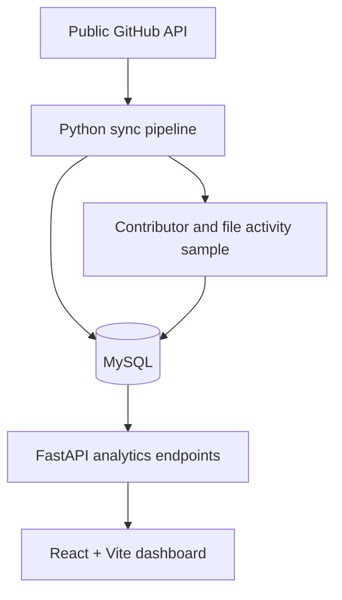

<!--
  Bus Factor Tracker
  Keep this README accurate: screenshots and deployment URLs should only be added when verified.
-->

<div align="center">

# 🚌 Bus Factor Tracker

### See the people, modules, and maintenance signals behind open-source project risk.

**A full-stack analytics dashboard for contributor concentration, code-module dependencies, and observable repository health.**

<br/>

[](https://www.python.org/)
[](https://react.dev/)
[](https://fastapi.tiangolo.com/)
[](https://www.mysql.com/)

<br/>

[Features](#-what-you-can-do) · [Architecture](#-how-it-works) · [Quick start](#-get-running) · [Database design](#-database-design) · [API](#-api-at-a-glance)

</div>

---

## 💡 Why Bus Factor Tracker?

A repository can have dozens of contributors and still depend on one person for its most important code. The **bus factor** is a simple way to think about that concentration: how many of the top contributors account for at least half of recorded commit activity?

Bus Factor Tracker turns public GitHub repository data into an explorable view of contributor concentration, historical bus-factor trends, file/module dependencies, and an explainable maintenance-signal score.

> [!IMPORTANT]
> These metrics are **signals, not predictions**. A low bus factor does not prove a project will fail, and a health score is not a measure of any contributor's burnout. Interpret results in the context of each project's goals and release practices.

## ✨ What you can do

<table>
<tr>
<td width="50%" valign="top">

### 📊 Risk dashboard
Browse tracked repositories by risk level and compare their bus-factor and contributor metrics.

### 📈 Historical trends
Inspect bus-factor snapshots over time to see how contributor concentration changes across syncs.

### 🕸️ Contributor dependency map
Explore links between contributors and top-level code modules. Spot areas where recent sampled activity is concentrated in one contributor.

</td>
<td width="50%" valign="top">

### 💯 Explainable project health
See a 0–100 indicator, factor-level evidence, weights, missing-data coverage, and the methodology behind the result.

### 🔎 Live GitHub search
Search public repositories and add projects to your tracked list.

### 🧰 Repository management
Add or remove tracked repositories and keep the configured repository list synchronized.

</td>
</tr>
</table>

## 🧭 How it works



1. **Collect** — the sync script retrieves repository metadata, contributor aggregates, weekly activity, and bounded samples of issues, pull requests, releases, and recent commit file changes.
2. **Store** — MySQL keeps repository entities and activity facts in related tables, with foreign keys and uniqueness constraints.
3. **Analyze** — SQL window functions calculate bus-factor snapshots; FastAPI exposes dashboard, health-score, and dependency-map data.
4. **Explore** — React presents the results, including the evidence and data limitations behind each metric.

## 🧱 Technology stack

| Layer | Tools | Responsibility |
|---|---|---|
| Frontend | React, Vite, Recharts | Dashboard, repository detail, visual analytics |
| API | Python, FastAPI, Pydantic | Repository data and analytical endpoints |
| Data collection | Python, Requests | GitHub API sync and bounded incremental collection |
| Database | MySQL 8.0+ | Relational storage, constraints, CTEs, window functions |
| Testing | Python unittest, GitHub Actions | Scoring tests and automated checks |

## 🚀 Get running

### Prerequisites

- Python 3.10 or newer
- Node.js 18 or newer
- MySQL 8.0 or newer
- A GitHub personal access token with the minimum permissions needed to read public repository data

### 1. Get the code

```bash
git clone https://github.com/iamakhilan/bus-factor-tracker.git
cd bus-factor-tracker
```

### 2. Create the database

For a **fresh database**, create it and load the schema:

```sql
CREATE DATABASE bus_factor_tracker;
```

Then from the project root:

```bash
mysql -u root -p bus_factor_tracker < sql/schema_mysql.sql
```

For an **existing database**, back it up first. If migration `001` has not been applied, run the migrations in order:

```bash
mysql -u root -p bus_factor_tracker < sql/migrations/001_health_and_module_ownership.sql
mysql -u root -p bus_factor_tracker < sql/migrations/002_5nf_file_ownership.sql
```

If `001` has already been applied, run only `002`. Migrations are one-time operations for existing installations; do not run them on a fresh database. More detail is in [Database normalization](docs/database-normalization.md).

### 3. Configure environment

Copy the example environment file and fill in your own values:

```bash
cp .env.example .env
```

Set the database connection values and `GITHUB_TOKEN` as required by your setup. Never commit real credentials or put the GitHub token in frontend variables.

### 4. Install Python dependencies

From the project root:

```bash
pip install -r requirements_mysql.txt
pip install -r backend/requirements.txt
```

### 5. Sync repository data

```bash
python scripts/sync_mysql.py
```

The sync process populates MySQL using the repositories configured in `repos.txt`. Run it again when you want to refresh the tracked data.

### 6. Start the API

```bash
cd backend
uvicorn main:app --reload --port 8000
```

API documentation is available at [http://localhost:8000/docs](http://localhost:8000/docs).

### 7. Start the frontend

In a second terminal:

```bash
cd frontend
npm install
npm run dev
```

Open [http://localhost:5173](http://localhost:5173).

For deployment, set `VITE_API_URL` to the deployed API URL in the frontend build environment and configure backend `CORS_ORIGINS` with the exact frontend origin(s). The GitHub token belongs on the server side only.

## 📐 Metrics, explained

### Bus factor

The bus factor is the **smallest number of highest-activity contributors whose combined recorded commits reach at least 50% of the repository's total recorded contributor commits**.

| Bus factor | Tracker risk category |
|---:|---|
| 1 | 🔴 Critical |
| 2 | 🟠 High |
| 3–4 | 🟡 Medium |
| 5+ | 🟢 Healthy |

These labels are this project's heuristic, not a universal industry standard.

### Project Health Score

The score is a deterministic, explainable indicator from 0 to 100. The default factor weights are configured in `backend/health_score.py`.

| Signal | Weight | What it looks at |
|---|---:|---|
| Contributor concentration | 30% | How much recorded commit activity belongs to the top contributor |
| Maintenance activity | 25% | Time since GitHub's latest repository push timestamp |
| Unresolved issue load | 15% | Open issues relative to the issue records stored locally, with a capped backlog penalty |
| Release recency | 15% | Time since the latest release collected by the sync process |
| Contribution diversity | 15% | Number of contributors with recorded commits |

Available factors are combined using their effective weights; **missing factors are omitted and the remaining weights are renormalized**. If no factor can be calculated, the API returns `null` rather than inventing a zero score.

#### Read the score with context

- Contributor aggregates are supplied by GitHub and do not represent a guaranteed, exact trailing-12-month window.
- Issue collection is bounded/incremental, so locally stored issues may not equal the repository's complete issue backlog.
- Release recency reflects the release records collected by the sync process.
- Recent pushes are an activity proxy; they do not prove issues are handled or releases are shipped.
- First-response time is based on the first observed comment by someone other than the issue author; public data does not reliably identify maintainers.
- Archived projects may be intentionally complete, so archived status is not currently treated as a negative health signal.

### Contributor dependency map

The sync pipeline samples up to 12 recent commit details and records changed file paths, contributors, commit counts, additions, and deletions. The API groups paths by their top-level directory (root files have a separate group) and builds contributor-to-module links.

A module is marked as a **potential bottleneck** when the sample contains only one contributor or when one contributor accounts for at least 80% of sampled touches.

> [!NOTE]
> This is a bounded recent sample, **not** complete Git history or `git blame`. The graph should be read as a snapshot of observed activity, not definitive code ownership. When a sample fetch fails, the previous successful sample is preserved.

## 🗃️ Database design

The schema separates repositories, contributors, contribution aggregates, issues, pull requests, releases, weekly activity, historical snapshots, modules, files, and file–contributor activity.

The normalized ownership design separates:
- `repo_module` — module identity within a repository
- `repository_file` — file identity and its module relationship
- `file_contributor_activity` — sampled activity for each file/contributor pair

A compatibility `module_ownership` view supports the existing read-only API query shape. The schema is designed around the application's declared dependencies; see [docs/database-normalization.md](docs/database-normalization.md) for candidate keys, decomposition rationale, migration steps, and verification queries.

## 🔌 API at a glance

The FastAPI server provides interactive documentation at `/docs`.

| Method | Endpoint | Purpose |
|---|---|---|
| `GET` | `/api/repos` | List tracked repositories, with optional risk and sorting filters |
| `GET` | `/api/repos/{owner}/{name}` | Repository detail and contributor breakdown |
| `GET` | `/api/repos/{owner}/{name}/trend` | Historical bus-factor snapshots |
| `GET` | `/api/repos/{owner}/{name}/health` | Health score, factor evidence, and coverage |
| `GET` | `/api/repos/{owner}/{name}/dependency-map` | Contributor-to-module graph and sampled ownership |
| `GET` | `/api/stats/summary` | Dashboard aggregate counts |
| `GET` | `/api/github/search?q=...` | Search public GitHub repositories |
| `POST` | `/api/repos` | Add a repository to track |
| `DELETE` | `/api/repos/{owner}/{name}` | Remove a tracked repository |

## 🧪 Tests

From the repository root:

```bash
python -m unittest discover -s tests
```

GitHub Actions is configured to run backend checks and build the frontend on pushes and pull requests.

## 📁 Project map

```text
bus-factor-tracker/
├── backend/
│   ├── main.py                  # FastAPI endpoints
│   ├── health_score.py          # Explainable health-score calculation
│   ├── db.py                    # MySQL connection helper
│   └── requirements.txt
├── frontend/
│   └── src/                     # React app, API client, components, styles
├── scripts/
│   └── sync_mysql.py            # GitHub API → MySQL sync pipeline
├── sql/
│   ├── schema_mysql.sql         # Fresh-install schema
│   ├── queries_mysql.sql        # Analytical SQL examples
│   └── migrations/              # Existing-database migrations
├── docs/
│   └── database-normalization.md
├── tests/
│   └── test_health_score.py
├── repos.txt
├── .env.example
└── requirements_mysql.txt
```

## 🛣️ Possible next steps

- Add configurable time windows for contributor activity
- Improve historical coverage for issue and pull-request analytics
- Add richer module-level ownership history
- Add integration tests against a disposable MySQL database

## 📄 License

This project is licensed under the [MIT License](LICENSE) if the repository's license file is present.

---

<div align="center">

**Built to make project-maintenance risk easier to inspect — and easier to discuss.**

<sub>If you find a metric confusing, start with its evidence and limitations before drawing a conclusion.</sub>

</div>
